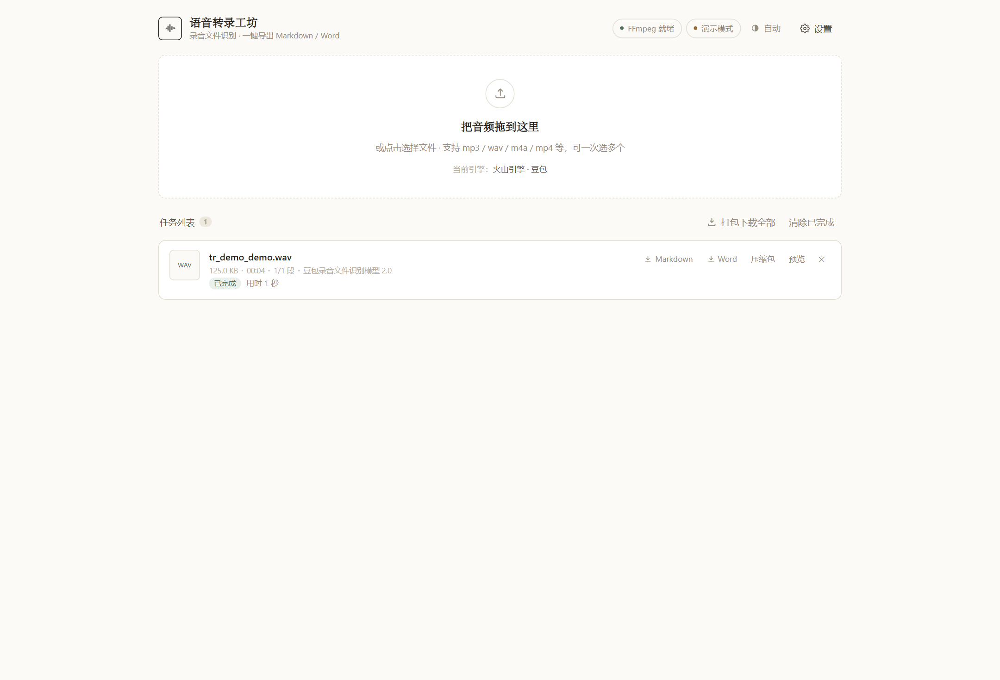

# 不听课 · SkippingClass

本分支候选版本为 **v1.1.0-rc.1**：新增可导出的净化逐字稿、可编辑 Word 公式与表格、课程记忆及历史指导。使用与升级见 [v1.1.0 说明](docs/UPGRADE_v1.1.0.md)，已正式发布的版本以 Releases 为准。

两个在**自己电脑上跑**的小应用，一套共用的语音识别层。都只监听 `127.0.0.1`，不联网也能用（端侧模式）。

| 应用 | 一句话 | 端口 |
|---|---|---|
| **[不听课](buketang/)** | 讲义 + 课堂录音 → **考前复习指导**（极限版 / 详细版 / 期末总复习） | 8759 |
| **[语音转录工坊](mp3-transcriber/)** | 任意录音 → **Markdown / Word / 纯文本**，带分句时间轴 | 8756 |

前者回答「这门课到底要背什么」，后者回答「这段录音说了什么」。两个都需要把语音变成文字，所以底层是同一个 `shared/asr`——一个 provider 层，五家引擎（本地 SenseVoice、火山豆包、OpenAI Whisper 系、阿里云百炼、本地 faster-whisper）。


<details>
<summary>语音转录工坊</summary>



</details>

---

## 一、快速开始

### 方式 A：下载发布包（推荐给使用者）

到 [Releases](https://github.com/display454/SkippingClass/releases/latest) 下载对应 zip，解压后双击启动：

| 下载 | 内容 |
|---|---|
| `tingke-suite-v1.0.0.zip` | 两个应用 + 共用层，一份 `.venv` 跑两个 |
| `buketang-v1.0.0.zip` | 只要「不听课」（含 `shared/`，独立可跑） |
| `mp3-transcriber-v1.0.0.zip` | 只要「语音转录工坊」（含 `shared/`，独立可跑） |

**Windows**：解压后双击 `start-buketang.bat` 或 `start-transcriber.bat`

**macOS / Linux**：
```bash
chmod +x start-buketang.sh && ./start-buketang.sh
```

首次启动会自建虚拟环境、装依赖（几分钟），之后秒开。浏览器会自动打开。

### 方式 B：克隆仓库

```bash
git clone https://github.com/display454/SkippingClass.git
cd SkippingClass
./start-buketang.sh          # 或 start-transcriber.sh
```

### 前置条件

1. **Python 3.10+**
2. **FFmpeg**（音频转码切片必需）
   - Windows：`winget install Gyan.FFmpeg`
   - macOS：`brew install ffmpeg`
   - Ubuntu：`sudo apt install ffmpeg`

FFmpeg 有没有装好，页面上会直接显示，不用猜。

### 一个 Key 都不填能用到什么程度

| 场景 | 需要什么 |
|---|---|
| 录音转文字 | **本地 SenseVoice**：点一次「下载模型」（230MB），之后纯 CPU、免费、离线 |
| 讲义 → 复习指导 | 一个 OpenAI 兼容的大模型 Key（DeepSeek / 通义 / Kimi 都行），或本机 **Ollama** |
| 只想看看界面 | 「演示模式」，不联网、不花钱，产物结构真实 |

使用 SenseVoice + 本机 Ollama，且不启用云端视觉模型或加载外链图片时，录音与讲义内容可留在本机处理。

---

## 二、两个应用各自在做什么

### 不听课

把一节课的讲义和录音一起丢进去，AI 对照两边，整理出考前真正要背的东西。

- **极限版**：只留 ★★★★ 以上的必背考点，一条一句，明天就考也能看完
- **详细版**：全部考点 + 课程脉络 + 考点预测 + 易错点 + 老师原话 + 拓展，**每个知识点旁边配讲义原始页面截图**
- **期末总复习**：几堂课归到一门课下，跨课去重，按「出现在几堂课里」排序

细节都在 [buketang/README.md](buketang/README.md)。

### 语音转录工坊

把音频拖进浏览器，选一家引擎，导出 Markdown / Word / TXT，带分句时间轴。

- 长音频自动切分并发提交，1 小时录音也稳
- 按引擎能力自动收缩分段长度（百炼 10 分钟、Whisper 23 分钟……不会白跑一趟被拒）
- 无时间戳的引擎会标注「时间估算」，不假装精确
- 结果页「阅读 / 原文」双视图，一键复制全文

细节都在 [mp3-transcriber/README.md](mp3-transcriber/README.md)。

---

## 三、仓库结构

```
SkippingClass/
├── buketang/                  # 「不听课」
│   ├── app.py                 # Flask 路由
│   ├── core/                  # 讲义解析 / 提示词 / 渲染 / 课程汇总
│   ├── web/                   # 前端（无构建，原生 JS）
│   ├── tests/                 # 离线自检 / 演示数据 / 交互验收 / 截图
│   └── data/                  # 运行时数据（git 忽略）
│
├── mp3-transcriber/           # 「语音转录工坊」
│   ├── app.py
│   ├── core/                  # 配置 / 任务队列 / 渲染
│   ├── web/
│   ├── tests/
│   └── data/
│
├── shared/                    # 两个应用共用
│   ├── asr/                   # 语音识别 provider 层（5 家引擎）
│   ├── audio_utils.py         # 探测、切片、分段长度自适应
│   ├── web/theme.css|js       # 共用设计系统 + 三态主题
│   ├── version.py             # 版本号唯一来源
│   └── devtools/cdp.py        # 浏览器驱动（只在测试与截图时用）
│
├── models/                    # 端侧模型（230MB，git 忽略，删了会自动重下）
├── start-buketang.bat|sh      # 共用 .venv 的启动脚本
├── start-transcriber.bat|sh
├── tools/                     # 打包与发布包冒烟（不是运行时依赖）
├── docs/                      # 发布说明
├── requirements.txt           # 两个应用合起来的依赖
├── LICENSE                    # MIT
└── THIRD_PARTY_NOTICES.md     # 依赖与模型的许可清单
```

### 为什么放在一个仓库

两个应用共享的东西比想象中多，而且**只有放在一起才不会漂**：

| 共用部分 | 不共用会怎样 |
|---|---|
| `shared/asr` | 五家引擎的签名、切片、重试、时间戳拼接要写两遍；改一处忘一处 |
| `shared/web/theme.css` | 同一个作者的两个工具，按钮圆角和灰色深浅会慢慢不一样 |
| `shared/version.py` | 两边版本号各写各的，发布时对不上 |
| `models/` | 230MB 的 SenseVoice 模型下两遍 |

代价是仓库里有两个 `app.py`，各自仍是**完全独立、可直接运行**的程序：只要带上它需要的 `core/`、`web/`、`shared/`，就能单独打包（见 Releases 里的单应用包）。

---

## 四、隐私

- 两个服务都只监听 `127.0.0.1`，同局域网的其他机器访问不到
- 讲义、录音、生成结果全部落在本机 `data/` 目录
- 语音：默认可以走端侧 SenseVoice；只有你主动选云端引擎时音频才会传给那一家
- 文本：只有你主动配了大模型 Key 才会把讲义内容发出去；Ollama 则是本机推理
- Key 只写入本机 `data/config.json`，配置接口只返回是否已保存；备份默认剥离 Key，恢复不导入连接设置
- 没有任何统计、上报、遥测

---

## 五、开发与测试

测试都不花钱，也不需要任何 Key：

```bash
# 不听课
cd buketang
python tests/e2e_offline.py     # 离线全链路：造讲义 + 静音音频 + 伪造模型返回
python tests/test_integrity.py  # 备份跨系统迁移、恢复回滚、配置继承和分段边界
python tests/test_update.py     # 净化稿、凭证保护、版本、记忆、Word 公式与表格
python tests/ui_update.py       # 新版真实浏览器交互
python tests/ui_check.py        # 98 项交互验收（自动起服务、自动造演示数据）
python tests/asr_local.py       # 14 项端侧转写（需已下载 SenseVoice 模型）

# 语音转录工坊
cd mp3-transcriber
python tests/selftest.py        # 演示模式跑完整链路
python tests/ui_check.py        # 46 项交互验收（自动起服务、自动上传音频）
```

`ui_check.py` 是自给自足的：生成演示数据 → 起临时服务 → 无头浏览器点一遍 → 关掉收拾干净，**不会碰你 `data/` 里的真实课堂**。

界面验收需要 Chrome / Edge / Chromium 之一（自动探测，也可以用 `CHROME_PATH` 指定），另需 `pip install websocket-client`。

推上去之后 GitHub Actions 会替你跑不需要浏览器的部分（`selftest.py`、`e2e_offline.py`、打包 + 解压起服务的冒烟）。`ui_check.py` 要真实浏览器，CI 里没有，所以**动了前端请本地跑一遍再提 PR**。

重拍 README 截图：

```bash
python tests/seed.py --dir C:/Temp/bt_demo                       # 造演示数据（不听课）
BUKETANG_DATA_DIR=C:/Temp/bt_demo python app.py --no-browser
python tests/shots.py http://127.0.0.1:8759/ assets/screenshots
```

### 环境变量

| 变量 | 作用 |
|---|---|
| `BUKETANG_DATA_DIR` | 把「不听课」的数据目录挪到别处（便携版、多份数据并行） |
| `TRANSCRIBER_DATA_DIR` | 同上，语音转录工坊 |
| `BUKETANG_PEER_CONFIG` | 指定邻居应用的配置文件路径（默认按同仓库约定找） |
| `PORT` | 固定端口，默认自动挑空闲端口 |

---

## 六、版本

当前源码 **v1.1.0-rc.1**。更新记录见 [CHANGELOG.md](CHANGELOG.md)，版本号单一来源在 `shared/version.py`，两个应用的页脚和 `/api/health` 都读它。

---

## 七、许可

本仓库自己的代码是 [MIT](LICENSE)。随便用、随便改，出问题自己担（尤其是考试）。

依赖项各有各的许可，其中一处需要留意：**PyMuPDF 是 AGPL-3.0**（商业授权双轨），讲义转 PDF 与截图靠它。你如果只是自己用、或原样转发这个仓库，没有任何额外义务；但如果**把打包好的可运行版本再分发出去**（挂到自己网站上、塞进 U 盘批量发），AGPL 要求你一并提供对应源码。完整清单见 [THIRD_PARTY_NOTICES.md](THIRD_PARTY_NOTICES.md)。
