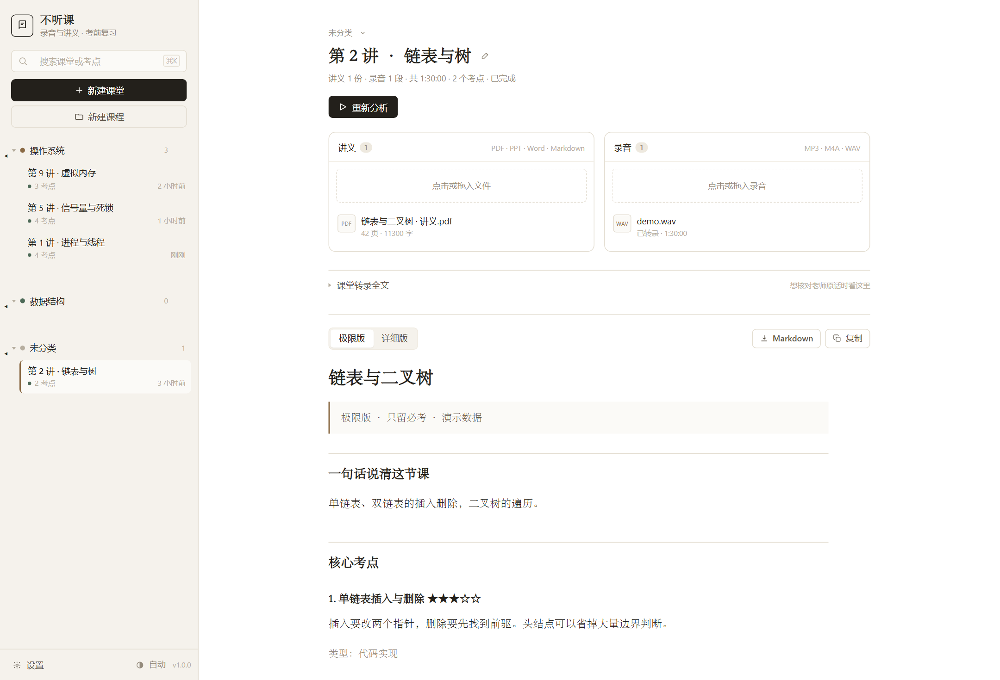
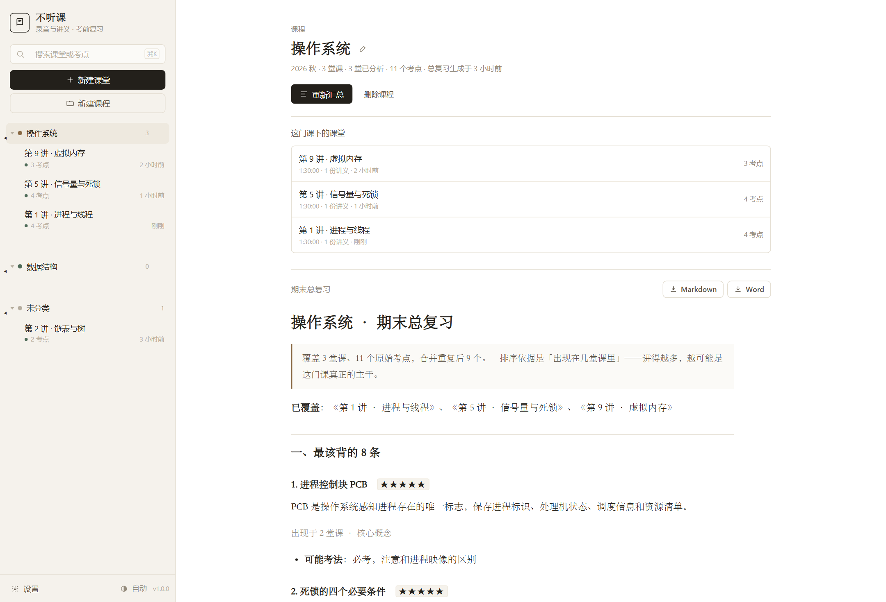
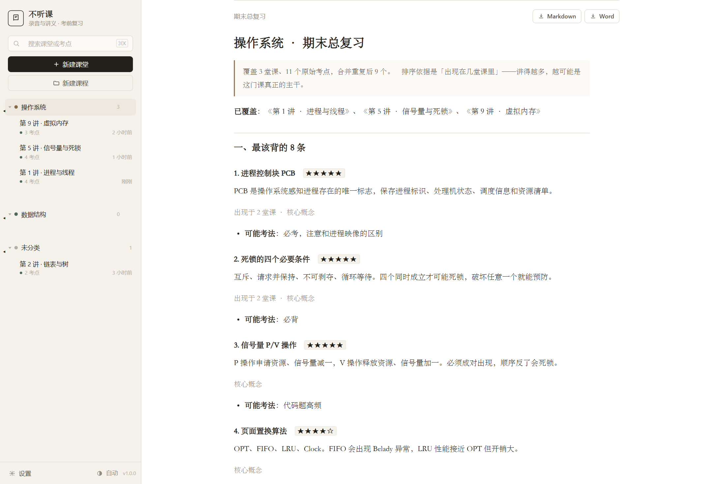
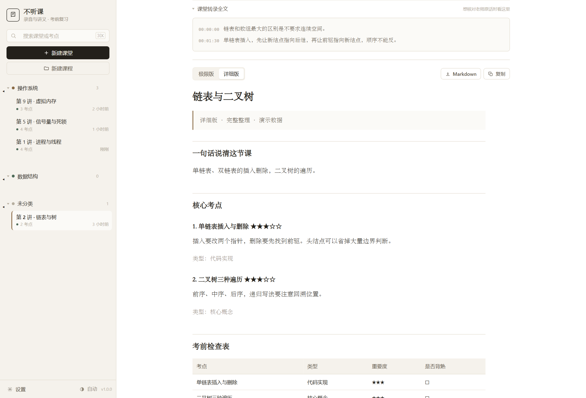
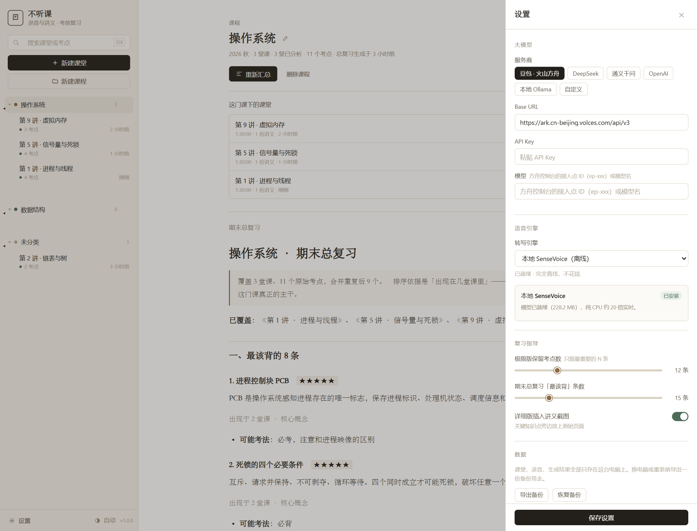
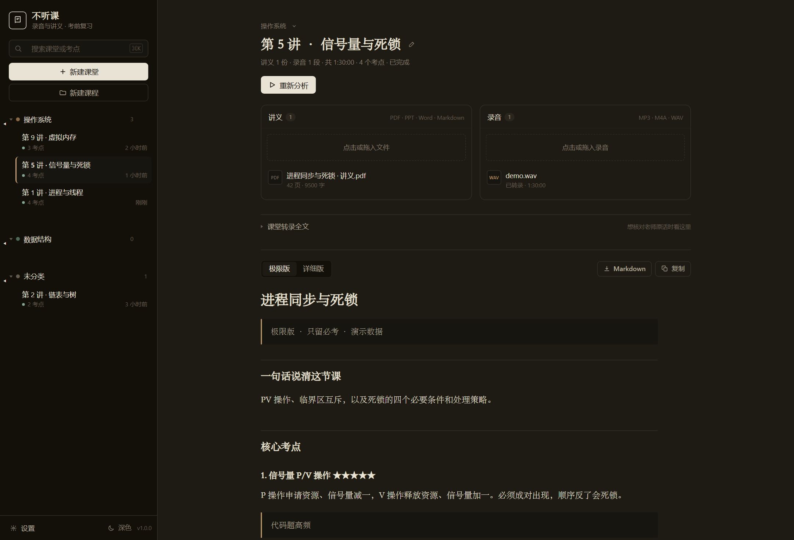
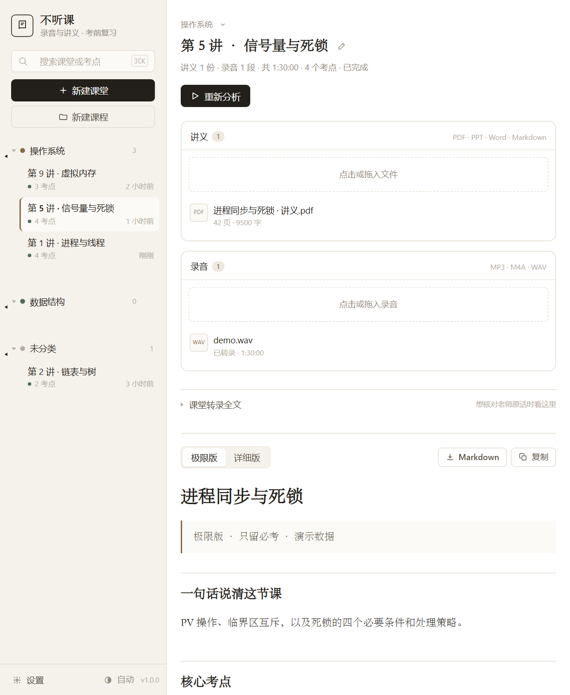

# 不听课

把一节课的**讲义**和**课堂录音**一起丢进去，AI 对照两边，整理出考前真正要背的东西。

三件事，它替你做完：

1. **单堂课**——讲义 + 录音 → 复习指导（极限版 / 详细版）
2. **一门课**——几堂课归到同一门课下 → 期末总复习（跨课去重、按出现频次排序）
3. **不花钱**——语音转写可以在你本机跑（SenseVoice 端侧），大模型也可以用本机 Ollama

| 版本 | 什么时候用 | 内容 |
|---|---|---|
| **极限版** | 明天就考，只有 10 分钟 | 只留 ★★★★ 以上的必背考点，一条一句，不配图，手机上也能速览 |
| **详细版** | 还有几天，要真正搞懂 | 全部知识点 + 课程脉络 + 考点预测 + 易错点 + 老师原话 + 拓展补充，**每个知识点旁边配讲义原始页面截图** |
| **期末总复习** | 整门课快考完了 | 把几堂课的考点合并成一份，只留真正贯穿全课的主干，附「分课索引」 |

- 讲义支持 PDF / PPT / PPTX / Word / MD / TXT，录音支持 mp3 / wav / m4a / mp4 等
- 一个课堂 = 这节课的所有讲义 + 所有录音，天然支持一对一、一对多、多对多
- 页码严格对齐：讲义统一转 PDF 再提取文字与截图，模型只说「第几页」，图片由程序按页码取
- 输出 Markdown + Word，Word 里截图是真实内嵌的，可以直接打印



<details>
<summary>课程视图：几堂课汇总成一份期末总复习</summary>














</details>

---

## 一、启动

**Windows**：双击 `start.bat`

**macOS / Linux**：
```bash
chmod +x start.sh && ./start.sh
```

首次运行会自动建虚拟环境装依赖，完成后浏览器打开 `http://127.0.0.1:8759`。

手动启动：
```bash
pip install -r requirements.txt
python app.py
```

### 前置条件

1. **Python 3.10+**
2. **FFmpeg**（录音转码切片必需，与语音转录工坊共用）
   - Windows：`winget install Gyan.FFmpeg`
   - macOS：`brew install ffmpeg`
3. **Office 或 LibreOffice**（把 PPT / Word 讲义转成 PDF，才能截图）
   - Windows 装了 Office 就能用（走 COM 自动化）
   - 没有 Office 也行：讲义直接给 PDF 就不需要这步，或者只导入 PDF

---

## 二、配置：两处，都可以不花钱

### 1. 大模型（必需，本应用独有）

点左下角 **设置** → 大模型。全部走 OpenAI 兼容协议，换 Base URL 就能换厂商：

| 服务商 | Base URL | 模型填什么 | 花钱 |
|---|---|---|---|
| 豆包 · 火山方舟（默认） | `https://ark.cn-beijing.volces.com/api/v3` | 方舟控制台的接入点 ID（`ep-xxx`）或模型名 | 按量 |
| DeepSeek | `https://api.deepseek.com/v1` | `deepseek-chat` | 按量，便宜 |
| 通义千问 | `https://dashscope.aliyuncs.com/compatible-mode/v1` | `qwen-plus` / `qwen-max` | 按量 |
| OpenAI | `https://api.openai.com/v1` | `gpt-4o` / `gpt-4o-mini` | 按量 |
| **本机 Ollama** | `http://127.0.0.1:11434/v1` | `qwen3:8b` | **0 元，数据不出本机** |
| 自定义 | 任何兼容端点 | — | — |

> 分析一节课通常要读几万字材料，建议用长上下文、便宜的模型（`deepseek-chat`、`qwen-plus` 这类）。

### 2. 语音识别（自动继承，不用配）

录音转写复用的是隔壁 **语音转录工坊** 的引擎配置——同一个模型没必要配两遍。在那边配好火山 / OpenAI / 百炼 / 本地任意一家，这边保存后立即生效。

设置抽屉里会显示当前继承到的引擎和是否就绪。想完全离线，就把那边切成 **本地 SenseVoice**（见下一节）。

---

## 三、端侧：不联网、不花钱能走到哪一步

应用里有两处可以「搬到自己机器上」，边界不一样，别混为一谈：

| 环节 | 端侧方案 | 效果 | 代价 |
|---|---|---|---|
| **语音转写** | SenseVoice-Small（sherpa-onnx）+ Silero VAD 分句 | **推荐**。中文 CER 约 3%，比同体量 Whisper 强一档；实测 i7-12700H 纯 CPU **23 倍实时**，一小时课约 2.6 分钟 | 一次性下载约 230MB 模型，之后永久离线 |
| **大模型分析** | 本机 Ollama（`qwen3:8b` / `qwen3:4b`） | 能用，但结构化输出（严格 JSON、页码对齐、考点分级）明显弱于 `deepseek-chat`，长讲义还容易漏读 | 要装 Ollama、占 5GB 左右内存/显存 |

具体建议：

- **转写一定用端侧**。它比大部分云端接口更准更快，还不要钱，没有理由不用。
- **分析默认用云端**。8B 级别的模型在「从三万字里挑出该背的 20 条」这件事上，稳定性和云端大模型差得肉眼可见。真想全离线，就选 `qwen3:8b` 并把「极限版保留考点数」调到 10 条左右，接受精度下降。
- 没装 Ollama 也能用：设置里点「检测」会告诉你本机有没有在跑、装了哪些模型、按内存推荐哪个尺寸。

---

## 四、怎么用

### 单堂课

1. **新建课堂** → 起个名字（例如「机器学习 第 5 讲 · 卷积神经网络」）
2. **导入讲义**：拖 PDF / PPT / Word / MD 进去，右侧会显示解析出多少页、多少字
3. **导入录音**：同一节课的一段或多段音频，可以分几次传
4. **开始分析**：进度条会依次显示「解析讲义 → 转录录音 → AI 通读 → 截取关键页 → 生成指导」
5. **看结果 / 下载**：顶部切「极限版 / 详细版」，右上角下载 Markdown 或 Word

一节课的材料多、录音长，整个过程几分钟到十几分钟不等。转录阶段花的时间最多——它和音频时长基本成正比。

### 一门课（期末总复习）

1. 侧栏点 **新建课程**，起个名字（例如「操作系统」）
2. 建课堂时直接选这门课；已经建好的课堂，点标题上方课程名后面的小箭头就能改归属（也可以就地「新建课程并归入」）
3. 进课程页，点 **重新汇总**
4. 汇总按「出现在几堂课里」排序，点右上角导出 Markdown 或 Word

**为什么按「出现在几堂课里」排。** 老师在不同课上反复讲的那个东西，比模型单次判定的 `importance` 更接近真实的考试权重。这是整门课汇总里唯一拿不到就做不出来的信号——单堂课的分析只有一堂课的信息。

**为什么汇总不再调一次大模型。** 合并这事是确定的：标题相似度去重（字符二元组 Jaccard，中文短标题比编辑距离稳）、取最长描述、取最高重要度、记下来源课堂。程序化做零成本、秒级、可复现，还不会在二次压缩里丢信息。

其它交互细节：

- 侧栏搜索框（`Ctrl/⌘ + K`）按课堂名**和考点内容**过滤——忘了哪节课讲过「信号量」，直接搜关键词
- 课堂名点一下就能就地改名；课程名也一样（点标题旁的铅笔）
- **删除课程**在课程页右上角：只删这个分组，课下的课堂会全部回到「未分类」，后面随时能再归到别的课程
- 课程名后面有个小箭头，点开可以随时把这堂课挪到别的课程下（或挪回未分类）
- 分析中可以随时取消；改了讲义或录音后，已生成的结果会标「结果待更新」，提醒你重跑
- 「未分类」是虚拟分组：还没归到课程下的课堂都在这里
- 右上角/侧栏底部的主题按钮：跟随系统 / 浅色 / 深色，三态循环，两个应用共用同一个偏好

### 结果页还能做什么

复习的时候最怕「这句老师到底怎么说的」，所以结果页留了三个回头路：

| 功能 | 在哪 | 解决什么 |
|---|---|---|
| **课堂转录全文** | 结果上方折叠条，展开才加载 | 复习指导是 AI 概括的，想核对原话就展开，带时间戳，能和录音对上 |
| **录音试听** | 素材面板里每个音频右侧的 ▶ | 点一下就地展开播放器（支持拖动进度条），不用切出去找文件 |
| **一键复制** | 结果右上角「复制」 | 直接把 Markdown 原文粘进 Obsidian / 语雀 / Word；浏览器不给剪贴板权限时弹「手动复制」框，全选好了按 Ctrl+C 就行 |

### 换电脑 / 备份数据

设置抽屉最下面「数据」一组：

- **导出备份** → 下载一个 zip，含全部课程、课堂、讲义解析结果、录音、生成的 Word / Markdown
- **恢复备份** → 选 zip 导入。导入前会先问你一句，并把当前数据自动另存到 `restore_backups/<时间戳>/`，导错了可以捞回来

备份**默认不含 API Key**（避免把密钥传来传去）。恢复到自己的机器上时，本机已经填过的 Key 会自动保留，不用重填。

> 想换电脑：老机器导出 → 拷 zip → 新机器装好应用 → 恢复备份。录音和已生成的复习指导都跟着走，不用重跑。


---

## 五、它做了什么

```
讲义 ──→ 统一转成 PDF ──→ 逐页提取文字（带全局页码）────┐
                          └→ 页面图片（按需渲染）      │
录音 ──→ 切片转码 ──→ 语音识别 ──→ 带时间戳的转写 ─────┤
                                                      ↓
                                       大模型对照两边，输出结构化考点
                                                      ↓
                            按引用页码回原 PDF 截取那几页
                                                      ↓
                                  极限版 / 详细版 × Markdown / Word
                                                      ↓
                              几堂课 → 程序化跨课合并 → 期末总复习
```

几个关键决定：

**页码为什么要全局摊平。** 一节课可能有两份讲义（课件 + 补充材料）。程序把所有页连续编号 1..N 交给模型，模型只输出整数页码；拿到结果后再映射回「第几份文件的第几页」，避免模型自己拼「PPT第3页」这种字符串拼错。

**为什么统一转 PDF。** PPT 直接截图和文字提取的页序容易对不上（隐藏页、母版页）。先转 PDF，文字和图片都从同一份 PDF 来，页码天然一致。

**分块但不二次汇总。** 材料超过 3.2 万字会按「讲义块 + 对应时段的录音」分段抽取，避免超出上下文。合并时用程序做去重（标题归一化后取并集，重要度取最大），不再花一次调用让模型汇总——省一次钱，也避免信息在二次压缩里丢失。

**模型输出一定会被规整。** 页码越界、时间戳格式不对、重要度写成字符串、字段缺失，全部在写入前修正，渲染层永远拿到干净数据。

---

## 六、产物长什么样

`data/lessons/<课堂ID>/outputs/`

```
极限版.md          极限版.docx
详细版.md          详细版.docx
assets/shots/m0/p002.jpg   ← 详细版引用的讲义截图
```

`data/courses/<课程ID>/`

```
期末总复习.md      期末总复习.docx
```

极限版：

```markdown
## 必背考点

### 1. 反向传播的链式法则　`★★★★★`

误差从输出层往前逐层回传，每层梯度等于上游梯度乘以本层局部梯度。

*讲义 P5 · 录音 00:31:20 · 公式*

- **可能考法**：大题必考，要能手推两层网络的梯度。
```

详细版在同一份内容上展开：加课程脉络、每条配讲义原页截图、考点预测带「为什么是考点」、易错点、老师原话（带时间戳）、以及明确标注为课外内容的拓展补充。

期末总复习是另一种结构：

```
一、最该背的 15 条        按跨课频次排序，每条标「出现于 N 堂课」
二、贯穿全课的主干       出现在过半课堂里的内容
三、完整考点清单         表格：考点 / 重要度 / 出现课堂 / 类型
四、这些地方可能这么考   合并后的考法归纳
五、容易错的            跨课合并的易错点
六、老师反复强调的       带时间戳的课堂原话
七、分课索引            想回头细看某一讲，从这儿跳
```

---

## 七、常见问题

**点「开始分析」没反应** — 看按钮是否灰着：缺讲义或缺录音时不可点；也会提示先配大模型。

**报「语音引擎还没配好」** — 去隔壁 **语音转录工坊** 的设置里把引擎密钥填上，或者切成「本地 SenseVoice」，这边自动生效。

**讲义解析失败 / 页数为 0** — 扫描版 PDF（纯图片）提不出文字。这类材料仍能截图，但模型读不到内容，建议换文字版或先 OCR。

**截图里的页码和讲义对不上** — 本应用所有截图都来自转好的 PDF，页序就是 PDF 页序。如果原 PPT 有隐藏页，PDF 里不含隐藏页，页码会与 PowerPoint 的编号略有差异。

**分析很久没动静** — 转录阶段和音频时长成正比。用云端引擎时一小时录音要几分钟；用本地 SenseVoice 大约 2~3 分钟。进度条会显示当前在处理第几段。

**汇总里「贯穿主干」是空的** — 这个章节要考点在过半课堂里都出现才有内容。3 堂课的话门槛是 2 堂；课太少或讲得太散就会空，属于正常。

**想省钱** — 转写切成本地 SenseVoice（免费）；文本模型用 `deepseek-chat` / `qwen-plus`；极限版考点条数调到 8~10 条；详细版关掉截图。

**数据存在哪** — `data/lessons/<课堂ID>/`：`lesson.json` 存状态与分析结果，`files/` 存原始讲义与录音，`ingest/` 存转好的 PDF，`outputs/` 存成品。`data/courses.json` 存课程，`data/courses/<ID>/` 存汇总。删掉整个课堂目录即彻底清空。

**想让数据放到别处**（比如放 D 盘、放 U 盘做便携版）— 启动前设环境变量 `BUKETANG_DATA_DIR`：

```bash
BUKETANG_DATA_DIR=D:/study/bt-data python app.py        # macOS / Linux
set BUKETANG_DATA_DIR=D:\study\bt-data && python app.py  # Windows CMD
```

**恢复备份后 Key 没了？** — 备份包默认剥离密钥是故意的。恢复到本机时会把原来填过的 Key 补回去；换到新机器则要重新填一次（设置里只显示掩码，不会明文导出）。

**深色模式在哪** — 侧栏最下面那个「自动 / 浅色 / 深色」按钮，三个状态循环。偏好存在浏览器本地，两个应用共用。

**想打印复习指导** — 直接 `Ctrl/⌘ + P`。打印样式会把侧栏、按钮、素材面板全部隐藏，只留正文，截图也能打出来。

---

## 八、目录结构

```
buketang/
├── app.py               # Flask 路由（课堂 / 课程 / 汇总 / 转录 / 备份 / 端侧模型）
├── core/
│   ├── config.py        # 大模型配置、语音引擎继承、Ollama 探测
│   ├── ingest.py        # 讲义转 PDF、提文字、渲页面
│   ├── llm.py           # OpenAI 兼容客户端 + JSON 兜底解析
│   ├── analyze.py       # 提示词、全局页码、分块与合并、结果规整
│   ├── compose.py       # 极限版 / 详细版 × md / docx
│   ├── courses.py       # 课程（一门课下挂多堂课）
│   ├── summarize.py     # 期末总复习：跨课去重、频次排序、渲染
│   └── store.py         # 课堂数据模型与执行流水线
├── web/                 # 前端（无构建，原生 JS）
├── tests/
│   ├── e2e_offline.py   # 离线端到端自检（不花钱，不需要任何 Key）
│   ├── seed.py          # 生成演示数据（固定 id，给验收和截图用）
│   ├── ui_check.py      # 98 项交互验收（自动起服务 + 演示数据）
│   ├── asr_local.py     # 14 项端侧转写验收
│   └── shots.py         # 拍 README 截图
└── data/                # 运行时数据（已被 .gitignore 忽略）

../shared/               # 两个应用共用
├── asr/                 # 语音识别 provider 层
├── web/theme.css|js     # 共用设计系统 + 主题切换
├── version.py           # 版本号唯一来源
└── devtools/cdp.py      # 浏览器驱动（只在测试/截图时用）
../models/               # 端侧模型（230MB，可删，删了下次重下）
```

自检（不需要任何 API Key）：

```bash
python tests/e2e_offline.py     # 离线全链路，自己起临时数据目录
python tests/ui_check.py        # 交互验收，自动起服务 + 造演示数据
python tests/asr_local.py       # 端侧转写，需要已下载模型
```

`e2e_offline.py` 会现场生成一份 PPT 讲义和一段静音音频，用伪造的模型返回跑完整条链路，校验页码映射、截图生成和四种产物，最后打印全部产物清单。

`ui_check.py` 一句命令跑完：生成演示数据 → 起临时服务 → 无头浏览器点 98 项 → 关掉收工，不碰你 `data/` 里的真实课堂。加 `--keep` 可以保留现场，加 `--url` 可以测已经跑着的服务。

---

## 九、隐私

- 服务只监听 `127.0.0.1`
- 讲义和录音只在你机器、你选的语音引擎、你选的文本模型之间传输
- 全端侧模式（SenseVoice + Ollama）下，一个字都不出本机
- 密钥只写入本机 `data/config.json`，页面显示的是掩码
