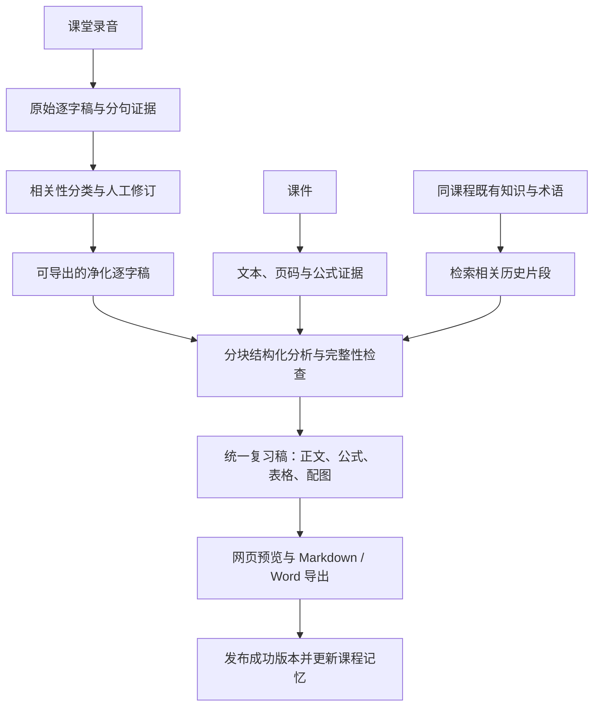

# 不听课 v1.1.0 更新方案与可行性检查

检查日期：2026-10-28。代码基线：`44a44dd`（v1.0.0）。

本文件保留实施前的检查与设计基线。当前已实现的功能、升级方式与限制见 [使用说明](UPGRADE_v1.1.0.md)；下文质量指标仍是验收目标，尚未用真实课程样本证明达到。

## 1. 结论与范围

四项需求可实现，建议将一次生成改成可检查、可复用的分阶段流程。最重要的变化是保存证据：原始转录、清洗决策、公式出处和历史课程引用都能回溯。

| 需求 | 当前基础 | 可行性与实施边界 |
|---|---|---|
| 过滤闲聊并导出中间文件 | 已有分句时间戳及原始转录数据，缺少语义清洗与独立导出 | 可行。采用带上下文的内容分类，保留原文，疑似相关内容默认保留；不能仅按说话人删除学生发言 |
| 更好的指导、少截图、LaTeX、表格、外链图片 | 已有结构化分析、网页表格及图片的基础显示，Word 主要写入普通段落 | 可行。需同时改分析结构、网页渲染与导出；只修改提示词不能让 Word 正确显示公式和表格 |
| 同课程前后记忆 | 已有课程分组；目前只在总复习时按标题相似度合并 | 可行。增加带出处、版本和课次顺序的课程记忆，生成时检索相关历史内容；首版可使用本地 JSON 索引 |
| 需求与漏洞分析 | 有离线、界面与发布测试 | 已复现配置安全、旧结果丢失和部分分析静默遗漏等问题，须先修可靠性与安全边界 |

建议保持 Python + Flask、现有共享 ASR 和文件存储体系。主应用先完成这些能力，语音转录工坊复用转录导出、清洗与安全组件；其余界面无需整体重写。

## 2. 已核实的问题与优先级

以下复现均使用临时数据目录、虚构密钥和模拟模型，未读取真实课堂数据、未向外部模型发送内容。

### 2.1 最高优先级：配置与本机接口安全

| 编号 | 问题及证据 | 影响 | 修改要求 |
|---|---|---|---|
| P0-S1 | `buketang/core/config.py:202` 的 `public_view()` 只掩码 LLM 密钥，原样保留自配 `asr.providers`。测试 `/api/config` 返回了虚构 ASR Key 的明文 | 自配语音引擎凭证暴露给前端响应；结合其他读取漏洞风险更大 | 所有配置响应统一移除秘密字段，只返回 `has_key`；保存接口同样处理。覆盖 API Key、access key 等所有提供商凭证，日志也须脱敏 |
| P0-S2 | `buketang/app.py:702` 恢复配置后补回原机密钥。测试中备份改变了 LLM `base_url`，旧 Key 仍被补回 | 后续调用可能把旧凭证发给备份指定的新服务地址；本次仅验证配置状态，没有实际发送凭证 | 默认仅恢复学习数据与非连接设置，保留本机端点和密钥。显式导入连接配置时，凭证须绑定规范化提供商与端点；端点变化要求重新填写凭证。LLM 与 ASR 一起覆盖 |
| P0-S3 | 两个 Flask 应用没有统一的 Host/Origin/写请求校验。测试客户端携带外域 `Origin` 与 `Host` 的 multipart `/api/restore` 得到 200 并恢复了测试备份 | 本机服务缺少跨站写入与 DNS rebinding 防线 | 限定本机 Host；浏览器写请求验证同源 Origin，并携带与启动实例绑定的 CSRF 标记。无 Origin 的自动化调用也须有正确标记；按实际监听端口生成允许来源 |

P0-S3 的证据证明服务端接受这类请求，尚未验证真实浏览器的完整攻击链。浏览器的本地网络访问策略可能构成额外限制，不能把它作为服务端的唯一保护。

### 2.2 最高优先级：结果完整性

| 编号 | 问题及证据 | 修改要求 |
|---|---|---|
| P0-R1 | `buketang/core/store.py:360` 开始重跑就设置 `guides={}`、`analysis=None`。模拟失败后，旧结果入口和分析确实被清空，旧 Markdown 文件仍在磁盘 | 新运行写入独立版本目录；通过校验后才切换当前版本。失败、取消或重启均保留上一个成功版本，取消文案须与实际行为一致 |
| P0-R2 | `buketang/core/analyze.py:163` 在后续分块出现 `LLMError` 时继续执行。模拟两块、第二块失败后仍返回第一块结果，没有缺块警告 | 每块记录输入范围、状态与校验结果；缺块禁止标成完整成功。支持重试失败块，用户可明确选择查看部分结果，导出也须标注覆盖范围 |

### 2.3 随本次更新修复的其他问题

| 优先级 | 位置与现状 | 建议 |
|---|---|---|
| P1 | `analyze.py:136` 按页数和录音行数比例配对，最多分四块。单页超长时，模拟块仍有 200,024 字符，超过 32,000 字符阈值 | 按模型输入预算持续切分超长页和段落，保留页码与句子 ID；语义检索匹配课件与录音，不能把比例配对当成真实对应 |
| P1 | `analyze.py:360` 在规整前合并原始模型返回；模拟 `importance="5.0"` 导致 `ValueError` | 每块先做结构与类型校验，再合并；顶层非对象、输出截断、错误字段要有可恢复错误 |
| P1 | `store.py:576` 将转录文本静默截取前 4,000 行；`_transcribe_one()` 没有传递 `estimated_time` | 完整保存、导出原始分句。模型输入通过分块控制长度；估算时间戳须一直带标记，不能显示成精确证据 |
| P1 | `compose.py:477` 的 Word 导出异常被直接忽略 | 显示各格式导出状态与错误；Markdown 成功、Word 失败要明确显示，并能仅重试 Word |
| P1 | `store.py:534` 收集大量引用页；`compose.py:130/269` 在每个考点下反复插同一页 | 区分“来源引用”和“确实需要插图”，增加全篇去重及图片预算 |
| P1 | 课程、课堂、任务与配置 JSON 使用直接覆盖写入；重试及删除运行中任务缺少一致的状态保护 | 使用临时文件加原子替换；运行中任务加互斥和取消确认；删除必须等待工作线程停止并核对运行版本 |
| P1 | 备份整体在内存构建，恢复未限制解压后总量、文件数与压缩比 | 改为临时文件流式输出，恢复前检查数量、总解压体积、剩余空间和业务结构；备份读取一致快照 |
| P2 | 模型下载使用直接 tar 解压；新富文本功能将增加外部输入 | 显式使用兼容 Python 3.10 的安全解压检查；外部资源校验、依赖固定版本与许可证说明随功能一起补齐 |

这些优先级针对当前本地桌面工具，不表示已发现互联网直接可利用的远程代码执行。

## 3. 拟定处理流程

转录、清洗、分析、导出分别有结果与状态；失败从对应阶段继续。只需要原始转录时不要求配置大模型；语义清洗与复习指导需要大模型，支持沿用本地推理服务。

## 4. 录音预处理与中间文件

### 4.1 清洗原则

原始 ASR 结果不可覆盖。清洗是对句段的相关性标注，净化逐字稿由保留句段拼接而成，默认不让模型自由改写事实。

分类建议：课程讲授、相关问答、考试与任务提醒、纠错补充、无关闲聊、无法判断。

- 课堂相关提问、回答、例子、教师更正、否定句和考试范围提醒必须保留。
- 仅明确无关的内容从净化稿隐藏；无法判断时保留并标注。
- 学生发言可能包含重要问答；多数 ASR 引擎也不能可靠识别谁是教师，因此不按“非教师说话人”删除。
- 分类时提供相邻句段和课程术语，避免把“这个不考”“刚才分母说错了”等短句误删。
- 轻度口头语整理或术语纠正可作为独立的可选操作，展示原文差异和依据，不冒充逐字原话。

模型只提交句段 ID、类别和理由，服务端检查 ID 属于本次输入，保证每个句段都得到处理。重复、遗漏或编造 ID 时拒绝发布清洗版本。模型自报置信度不能作为正确性的唯一依据。

### 4.2 数据与导出

每个句段保存 `segment_id`、`audio_id`、ASR 版本、起止时间、原文、说话人（可空）、时间精度、分类及人工覆盖记录。多个录音同时保存原文件内时间和课堂合并时间，便于准确试听。

首版导出：

| 文件 | 用途 |
|---|---|
| `原始逐字稿.md` | 全文与时间戳，不受 4,000 行截断影响 |
| `净化逐字稿.md` | 进入指导生成的中间材料；展示清洗版本及保留范围 |
| `转录标注.json` | 所有句段、剔除理由、出处与人工修改，便于检查与迁移 |

界面提供“原文 / 净化稿 / 已剔除内容”三个视图，可恢复任意被剔除句段。人工改动生成新版本并使下游分析失效；重新分析无需再次调用 ASR。SRT/VTT 可以后续增加，不能把估算时间戳伪装成字幕级精度。

## 5. 复习指导质量、公式与辅助内容

### 5.1 调整分析内容

将现有 `detail` 大段字符串逐步扩展为少量有类型的内容：正文、公式、表格、配图引用。保留旧字段兼容 v1.0 数据，复用现有考点、章节、易错点与教师强调结构。

每个重要知识点优先回答：它是什么、为什么或如何推导、何时适用、容易混淆什么、依据在哪里。需要时给一个有解释的小例子。

- 根据有效内容决定考点数量，取消短课也硬凑 15 条、长课最多 26 条的约束。
- 使用直接、准确、适合复习的语言，删除套话与重复解释；首次出现的术语给定义，后文保持一致。
- 区分“教师明确强调”“课件核心内容”“系统推测题型”；仅模型猜测不能写成教师原话或保证会考。
- 长课概述须覆盖全部成功分析块，不继续只使用第一块概述。
- 每个事实、教师引语和公式保留本课或历史课程出处；页码和时间戳须落在实际输入证据中。相关性仍需语义核对，存在页码本身并不足以证明引用正确。
- 将讲义和转录作为待分析数据，不执行其中的提示指令；历史生成内容也不提升为系统指令。

### 5.2 LaTeX 与公式正确性

建议首版采用常用 LaTeX 数学子集，支持行内 `$...$`、块级 `$$...$$`、分式、上下标、求和、积分、矩阵、分段与对齐公式。

公式结构至少包含：LaTeX 原文、变量解释、成立条件、推导说明（可选）、材料页或转录句段引用、核对状态。JSON 中反斜杠须正确转义，并拒绝意外控制字符；公式内容在行内格式处理前保护，防止下划线、星号和表格竖线破坏表达式。

重要边界：当前模型请求只接收文本，PDF 取文字也不能保证恢复公式布局。扫描件、图片公式、复杂分式以及口述中缺失的上下标，不能靠改提示词保证准确。

推荐流程：先用课件可提取文本与教师讲解建立证据；遇到公式图像时，提供页面或区域选择，用户可启用兼容的视觉模型识别，或使用另行配置的本地 OCR。未具备识别能力、证据冲突或仍无法确认时，保留必要小图与“待核对”标记，不能编造一个漂亮但错误的公式。

“LaTeX 能渲染”只证明语法可用。还须检查变量、上下标、分母、正负号与成立条件；教师口述与课件冲突时保留两种来源及更正关系。二次模型检查可以辅助，不能当作数学正确性的证明。

### 5.3 网页、Markdown 与 Word 一致

| 输出 | 推荐方案 | 需验证事项 |
|---|---|---|
| 网页 | 本地随包分发 KaTeX 的脚本、样式和字体；Markdown 解析器禁用原始 HTML，公式节点单独渲染 | 离线可用、复杂公式横向滚动、暗色与打印、错误公式不使整页崩溃 |
| Markdown | 保留 LaTeX 原文、常用表格与相对资源路径 | 导入常用笔记软件后结构完整；兼容性依赖目标软件的数学功能 |
| Word | 建议用 Pandoc 将统一稿转为 DOCX，通过参考模板保留样式；公式输出为可编辑 OMML，表格输出为真正的 Word 表格 | 先用公式与表格样本验证，不把 LaTeX 直接作为普通文字写入 Word |

Pandoc 是拟新增的外部运行依赖，需要安装检测、版本记录与明确缺失提示；本机当前未检测到该命令。首个实施验证应使用可独立解压的工具版本，确认公式与现有版式后再固定依赖。DOCX 转换不需要为此另建完整 LaTeX 排版环境。不能把“官网支持 OMML”当成已验证所有公式都能无损转换。

KaTeX 按不信任输入配置 `trust:false`，限制表达式长度、宏展开和显示尺寸，宏状态不跨课程共享。图片通过独立的资源处理流程加载，不能借公式命令绕过图片策略。

### 5.4 少截图，保留有用图

拟定默认策略为“仅必要配图”，全篇最多 3 张、同一来源图只插一次，每个知识点最多 1 张；图片预算可调整为无图、必要、完整。

- 纯文字页、可准确重写的公式、能表达成表格的内容不插整页图。
- 电路、结构、几何、实验装置和不可替代的曲线图优先保留；其他知识点引用已插入的图号。
- 保留所有来源页码，并支持点开原页，不因减少截图而降低可核对性。
- 首版允许选择必要原页；局部裁图可在人工选择区域或可靠识别区域后启用，避免让文本模型凭空猜坐标。

### 5.5 表格与外链图片

表格优先用于概念对比、算法条件、公式适用范围和易错点。使用明确的列与单元格结构，限制宽度与数量；不要把长篇解释全部塞进表格。

外部图片支持分两步：用户输入或已核实来源的 HTTPS 地址，在界面明确来源并按需加载；需要离线导出时，用户选择缓存到本地。首版不要求增加联网搜图服务，也不让模型凭空输出“看起来存在”的图片地址。

远程加载会向图片站点发出请求；默认按需加载并设置不发送 Referrer。仅这样做仍不能隐藏用户 IP。离线模式显示本地图片或链接占位，网络失败时正文仍完整。

后端缓存须限制来源与请求：拒绝本机/内网/链路本地地址，逐次检查重定向和解析地址，限制超时、下载大小及像素数量，校验实际图片类型；首版只缓存可安全解码的栅格图片。禁止 `file:`、任意本地路径、脚本协议和不受控 SVG。

调用 Pandoc 前将所有图片改为经校验的版本目录内资源，禁止转换器自行下载模型给出的 URL 或读取任意本机文件。资源失效时显示说明，不静默替换成其他图片。

## 6. 同课程前后记忆

### 6.1 记什么、从哪里来

按课程与学期隔离，保存四类条目：术语及符号约定、已讲知识与前置关系、重要公式及条件、教师的更正和明确考试提醒。每条记录带来源课堂、发布版本、证据引用、核对状态和适用范围。

历史分析可自动提取候选记忆；有明确来源且通过校验的条目才参与自动复用。无法确认的条目进入待核对区，模型的自我评价不能替代证据。保留来源记录，避免连续摘要再摘要造成错误累积。

### 6.2 怎样使用

- 增加可调整的授课顺序/日期，课程创建顺序不代表授课先后。
- 每次先按本课术语和材料检索相关历史条目，并包含必要的近期上下文；限制为输入预算的一小部分，建议上限 10%–15%，绝对上限另配。
- 首版用本地 JSON 记录与词项检索即可；实际出现检索不足后再评估向量索引，避免先增加数据库和模型负担。
- 在指导中标注“本课内容”“前课回顾”和“后续更正”，提供跳转出处，避免把历史讲解归为本课教师原话。
- 默认只使用授课顺序早于当前课的资料；后续课程明确更正旧知识时，保存更正链。重新生成旧课可显式选择“使用后续更正”，不偷偷改写旧稿。
- 同名概念、不同符号定义或相反结论不强行合并；保留冲突和条件，交给用户核对。

### 6.3 失效与用户控制

课堂重命名不应丢失记忆来源；换课、删除、修改逐字稿、修订分析或选择另一版本，均使相关索引失效并重建。生成任务记录所用的记忆快照，任务进行中不改变其上下文。

课程页提供启用/停用记忆、查看来源、修改术语约定、标记错误与重建入口。用户补充笔记单独标注，不能变成“教师已讲事实”。备份同时保存索引与必要来源，可从原数据重建；不把一门课的内容带入另一门。

## 7. 数据、状态与接口修改

### 7.1 版本与复用

保留旧 `lesson.json` 和现有接口的读取兼容，增加 `schema_version`、分阶段状态及当前成功版本指针。新产物使用相对路径，恢复时校验路径始终位于对应课堂或课程目录。

建议逻辑分层：

| 层 | 关键标识与复用依据 |
|---|---|
| 原始转录 | 音频内容指纹、ASR 提供商/模型与识别参数、ASR 版本 |
| 清洗结果 | 原始转录版本、分类规则/提示版本、人工修改、实际使用的课程术语快照 |
| 分析结果 | 材料指纹、清洗版本、课程记忆快照、模型与提示配置 |
| 网页及导出 | 分析版本、渲染器/模板版本、图片策略、已缓存资源 |

这样修改样式、图片数量或 Word 模板只需重新导出；修改提示词可复用转录；改录音或识别模型才需要重做 ASR。复用必须检查依赖变化，不能只检查输出文件是否存在。

工作线程写自己的运行目录，通过完整性校验后再发布；取消检查贯穿 LLM 调用前后和导出前后。无法立即中断的外部调用要如实显示“等待当前调用结束”，结果返回后仍不得发布已取消版本。

### 7.2 拟新增或扩展接口

| 接口 | 行为 |
|---|---|
| `POST /api/lessons/<id>/transcribe` | 单独转录，无需 LLM 配置 |
| `POST /api/lessons/<id>/preprocess` | 创建清洗运行，可复用原始转录 |
| 现有 `GET /api/lessons/<id>/transcript` | 保留默认原文行为，可扩展查询指定视图与版本 |
| `GET /api/lessons/<id>/transcript/download` | 选择原文/净化稿及 Markdown/JSON |
| `PATCH /api/lessons/<id>/transcript/segments/<segment_id>` | 修改分类或恢复句段，带版本号以避免覆盖并行修改 |
| 现有 `POST /api/lessons/<id>/run` | 继续支持完整流程，并按有效依赖复用上游结果 |
| `GET /api/courses/<id>/memory` | 查看记忆、来源、冲突与索引状态 |
| `POST /api/courses/<id>/memory/rebuild` | 根据有效来源重建 |

所有写请求采用统一的本机请求校验。页面只有阶段、结果、版本、错误等用户需要的信息，不向普通使用流程暴露缓存键、文件内部结构等实现细节。

### 7.3 文件改动范围

| 文件 | 修改职责 |
|---|---|
| `buketang/core/store.py` | 分阶段执行、取消、复用、保留旧结果与成功版本发布 |
| 新增 `shared/transcript.py` | 规范化分句证据、导出与时间精度，供两应用复用 |
| 新增 `buketang/core/preprocess.py` | 课程相关性分类、覆盖检查、清洗记录与人工覆盖 |
| `buketang/core/analyze.py` | 按预算分块、逐块校验、明确缺块、公式/表格/出处结构与提示 |
| 新增 `buketang/core/memory.py` | 课程记忆索引、检索、快照、失效和更正关系 |
| `buketang/core/compose.py`、`summarize.py` | 统一稿、图片去重、课程汇总保留出处、Word 导出状态 |
| `buketang/core/ingest.py` | 保存公式证据与可选视觉识别的页面/区域入口 |
| `buketang/app.py`、`mp3-transcriber/app.py` | 阶段接口、配置脱敏、连接设置恢复策略、运行状态保护 |
| 新增 `shared/local_security.py` | 共用 Host、Origin 和写请求标记校验 |
| `buketang/core/config.py`、`llm.py` | 凭证端点绑定、输入预算、生成及格式校验错误 |
| `buketang/core/backup.py` | 新版本路径与结构校验、资源限制、迁移兼容 |
| 两应用 `web/` 及 `shared/web/` | 中间稿视图、来源跳转、离线数学与安全富文本组件 |
| `requirements.txt`、启动脚本、打包工具、第三方说明与 CI | 新依赖、导出能力检测、静态字体与资源完整性、回归测试 |

具体模块拆分在实施时根据实际改动规模调整，不为计划表提前建立空模块。

## 8. 用户可能还需要什么

| 优先级 | 用户需求 | 纳入方式 |
|---|---|---|
| 本次必需 | 原始识别错字能改、误删能恢复、公式可核对 | 原文证据、编辑净化稿、显示修改差异与公式来源 |
| 本次必需 | 失败不用重新识别整堂课、生成不丢旧稿 | 分阶段复用、失败块重试和成功版本历史 |
| 本次必需 | 清楚是否漏处理、等待多久以及是否继续花钱 | 覆盖范围与阶段真实进度；调用前显示调用规模估算，调用后仅在服务返回用量时显示真实用量 |
| 本次必需 | Word、网页与笔记软件内容一致，资源离线可用 | 共用结构化稿，导出公式/表格；可选打包 Markdown 与本地图片 |
| 本次必需 | 同一课程批量导入、顺序明确、术语统一 | 课程级批量操作和可调整课次，复用词汇表与已确认记忆 |
| 后续可选 | 只上传课件、只上传录音、导入已有逐字稿 | 当前流程同时强制课件与录音，可在核心链路稳定后增加独立入口；已有稿导入在本次模型中预留规范格式 |
| 后续可选 | 从“不懂”到“会做”，而不只是更短的摘要 | 根据有出处知识点生成自测题、答案与推导，标注生成内容；不与首版富文本改造同时扩张 |
| 后续可选 | 跨学期检索、遗忘提醒、移动端使用 | 另行验证使用频率和成本后排期 |

## 9. 实施顺序与验收

| 里程碑 | 交付内容 | 进入下一步的条件 |
|---|---|---|
| M0：可靠性与安全补丁 | 配置响应无明文凭证、恢复不改绑密钥、同源保护、重跑保留旧稿、缺块显式失败、原子写入 | 对已复现问题补充回归测试，两个应用的必要旧测试通过 |
| M1：转录中间层 | 单独转录、清洗分类、可恢复剔除、原文/净化稿/JSON 导出、阶段复用 | 完整证据映射与人工标注测试达标；旧数据可读 |
| M2：复习稿与富文本 | 证据化提示、动态覆盖、公式结构、少截图、表格、外链按需加载、网页与 Word 一致 | KaTeX 与 Word 公式样例实际验证；离线资源、错误降级与图片安全测试通过 |
| M3：课程记忆 | 有序检索、术语与公式约定、更正链、快照及失效重建 | 跨课和跨课程样例、修改删除后的失效测试通过 |
| 发布验收 | 新旧数据、三种发布包、真实课程人工复核、更新文档 | 全链路及 CI 通过，再确定正式 v1.1.0 发布；不把方案或模拟测试当作功能已经完成 |

M0 可作为独立修复版本先交付。M1–M3 构成本次完整功能更新。视觉/OCR 的具体引擎和 Pandoc 分发方式需要先做小样验证，再固定到安装包与依赖说明。

### 9.1 必须自动验证

1. 失败、取消、进程重启和 Word 导出失败不破坏上一成功结果；同一课堂不能并行发布两个运行结果。
2. 任意块失败或任何课件解析失败均能看到覆盖缺口；超过四块、单页超长和超 4,000 行录音不会静默截断。
3. 清洗前后每个句段都能映射，遗漏、重复及不存在的 ID 被拒绝；估算时间戳保持估算标记。
4. 各提供商秘密字段不会出现在配置响应、导出默认内容或日志；恢复不同端点不会沿用旧凭证。
5. 外域 Origin、不受信任 Host、无效写请求标记被拒绝；正常页面、命令行测试与备份恢复正常使用。
6. 网页与 DOCX 都包含分式、矩阵、上下标、对齐公式及表格；DOCX XML 存在数学节点，Word 中可编辑；错误公式有明确说明。
7. 同页多次引用只插一次图，默认图片总量受限，来源引用不丢；外链失败、离线与不支持图片类型可正常阅读正文。
8. 不读取任意本地图片或访问内网图片地址；超限资源、危险链接与嵌入脚本不能绕过富文本处理。
9. 课程之间不混用记忆，当前课不会看到未允许的后续课；改课次、移动/删除课堂和修订源结果后正确失效。
10. v1.0 数据备份可升级恢复，新版本备份往返完整；发布包包含公式脚本、样式、字体和相应第三方说明。

### 9.2 必须用真实课程人工评估

至少覆盖理工科公式课、概念/论述课和课堂问答较多的课程，每类包含连续几讲。使用用户有权处理并同意用于测试的录音与课件，避免直接向外部服务发送未授权课堂材料。

初始验收目标：被删句段中人工确认无关的比例至少 95%；标注样本中的明确考试提醒、相关问答和纠错不得被误删；所有输出公式有出处或清晰的补充/待核对标记；代表性的关键公式逐式核对，不能仅凭“渲染成功”通过。

同时对照 v1.0 盲评覆盖度、事实正确性、解释是否可用于复习、截图必要性和跨课一致性。清洗后字数减少量与考点数量均不作为越多越好的指标。这些质量目标需在取得实际样本后验证；本轮尚无真实课程输入，不能声称指导质量已经提高。

## 10. 官方资料与技术选择依据

- [KaTeX 浏览器集成](https://katex.org/docs/browser)：可随包提供脚本、样式与字体；本应用应保持离线可用。
- [KaTeX 安全选项](https://katex.org/docs/security)、[配置](https://katex.org/docs/options)：不可信输入的外部资源命令、宏展开与尺寸需要控制。
- [Pandoc 数学输出说明](https://pandoc.org/MANUAL.html#math)：Markdown 数学可转换为 DOCX 的 OMML；[安装说明](https://pandoc.org/installing.html)提供跨平台与 Windows 独立解压方式。
- [Flask 安全说明](https://flask.palletsprojects.com/en/stable/web-security/)：应用需自行处理跨站请求及 Host 边界。
- [OWASP SSRF 防护建议](https://cheatsheetseries.owasp.org/cheatsheets/Server_Side_Request_Forgery_Prevention_Cheat_Sheet.html)：为拟增加的图片缓存处理地址、重定向与访问目标限制。

资料只证明相关工具支持这些技术路线；具体公式保真、课堂清洗和记忆效果仍须按上述验收样例验证。
