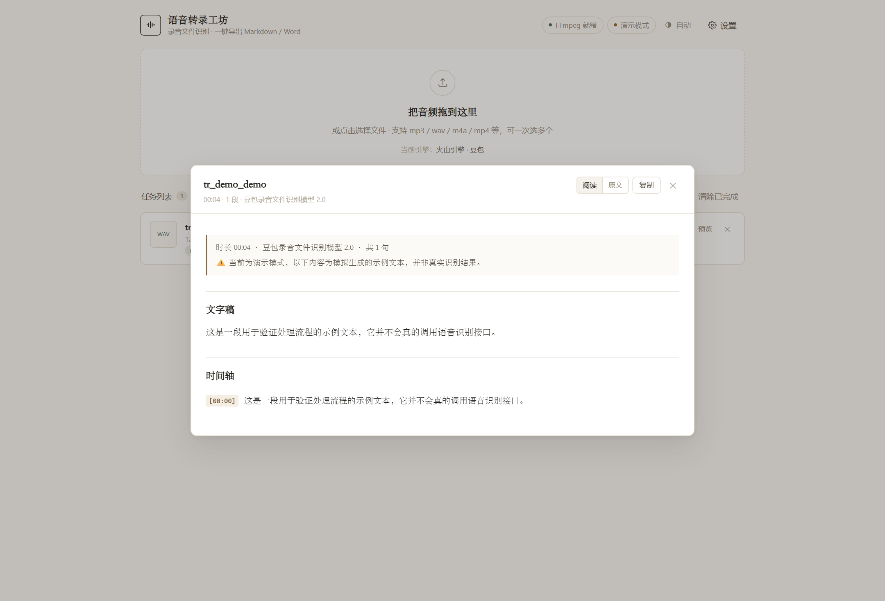
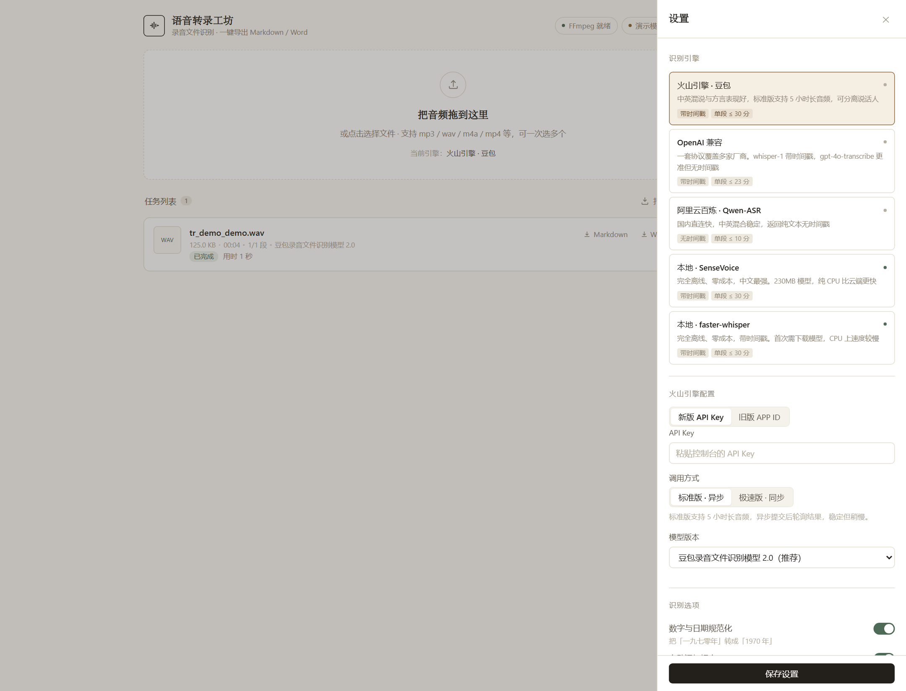
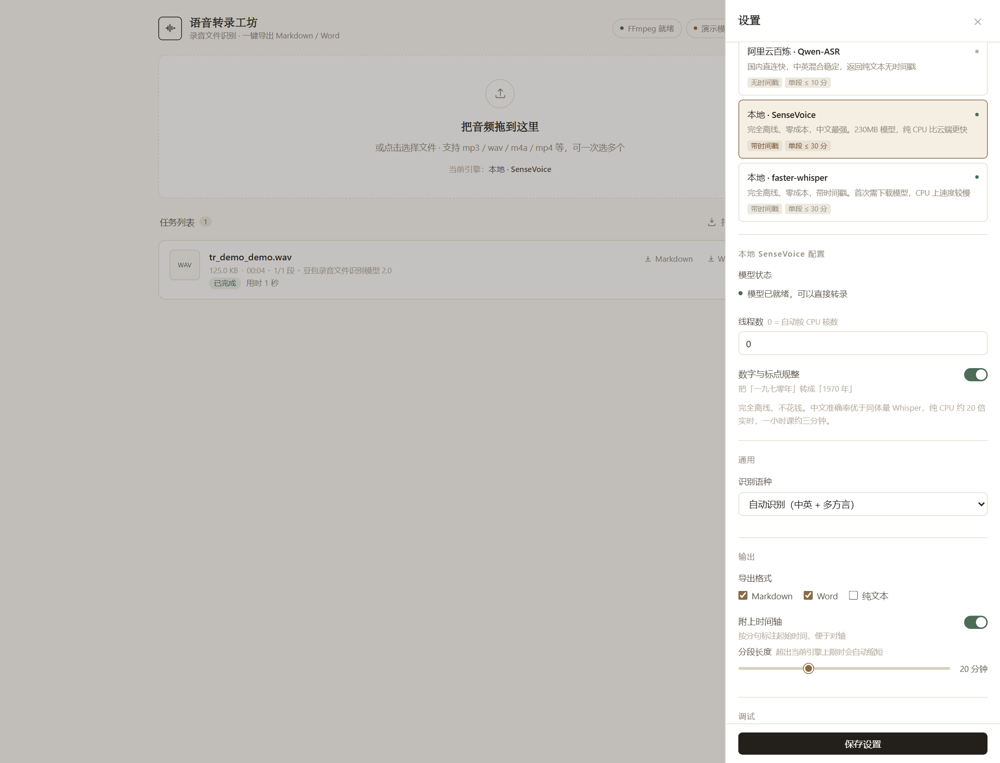
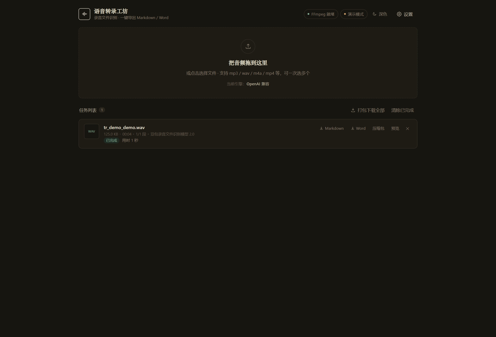
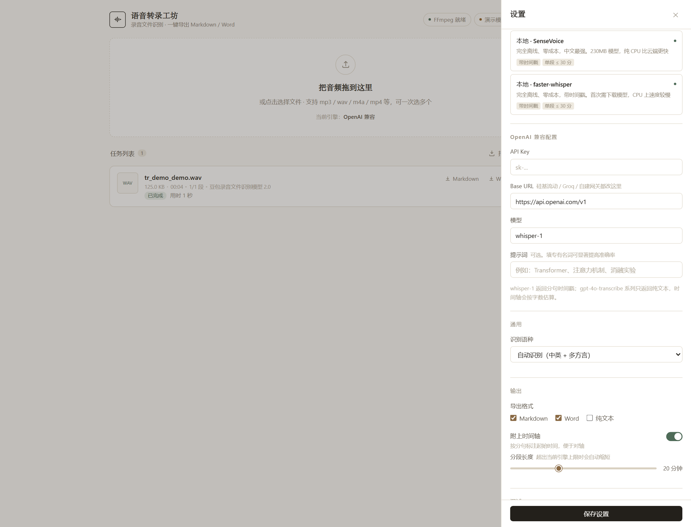

# 语音转录工坊

本地跑的录音转文字小应用。把音频拖进浏览器，选一家语音识别引擎，直接导出 **Markdown / Word / 纯文本**，带分句时间轴。

- 五家引擎可切换：**本地 SenseVoice（推荐，免费离线）**、火山引擎豆包、OpenAI Whisper 系、阿里云百炼、本地 faster-whisper
- 全程本地运行，音频只在你机器和所选引擎的接口之间传输
- 长音频自动切分并发提交，1 小时录音也能稳稳处理
- 批量拖入多个文件，排队依次处理，可一键打包下载全部产物
- 结果页可以「阅读 / 原文」两种视图切换，一键复制全文，直接粘进笔记软件
- 跟随系统 / 浅色 / 深色三态主题，晚上整理笔记不刺眼
- 没配密钥时可用「演示模式」先跑通流程看效果


<details>
<summary>结果预览 / 引擎设置 / 深色模式 / 窄窗口</summary>










</details>

---

## 一、启动

**Windows**：双击 `start.bat`

**macOS / Linux**：
```bash
chmod +x start.sh && ./start.sh
```

首次运行会自动建虚拟环境并装依赖，完成后浏览器自动打开 `http://127.0.0.1:8756`。

也可以手动启动：
```bash
pip install -r requirements.txt
python app.py
```

### 前置条件

1. **Python 3.10+**
2. **FFmpeg**（音频转码与切片必需）
   - Windows：`winget install Gyan.FFmpeg`
   - macOS：`brew install ffmpeg`
   - Ubuntu：`sudo apt install ffmpeg`

页面右上角会显示 `FFmpeg 就绪` / `缺少 FFmpeg`，一眼能看出来。

---

## 二、五家引擎

设置页第一屏就是引擎选择，点哪张卡片下面就显示哪家的配置项，各家凭证互不覆盖，随时切换。

| 引擎 | 需要什么 | 时间戳 | 单段上限 | 特点 |
|---|---|---|---|---|
| **本地 SenseVoice**（推荐） | 无（点一下下模型，约 230MB） | 有（真实测量） | 30 分钟 | 完全离线、零成本；中文比同体量 Whisper 强一档，纯 CPU 约 20 倍实时 |
| **火山引擎 · 豆包**（默认） | API Key，或 APP ID + Access Token | 有 | 30 分钟 / 20MB | 中英混说、方言表现好，可分离说话人，支持 5 小时长音频 |
| **OpenAI 兼容** | Base URL + API Key + 模型名 | `whisper-1` 有，`gpt-4o-transcribe` 无 | 23 分钟 / 24MB | 一套协议通用 OpenAI、硅基流动、Groq 等 |
| **阿里云百炼** | API Key | 无 | 10 分钟 / 7MB | 国内直连快，中英混合稳定，返回纯文本 |
| **本地 faster-whisper** | 无（首次自动下模型） | 有 | 30 分钟 | 完全离线、零成本；CPU 上较慢，可选 tiny ~ large-v3 |

分段长度会随引擎自动收缩：页面上填的「分段长度」只是上限，实际取「你填的值 / 引擎时长上限 / 引擎体积上限」三者最小值。换成百炼时 20 分钟会被自动压到 10 分钟，不会白跑一趟被接口拒绝。

没有时间戳的引擎（百炼、`gpt-4o-transcribe`）会按字符数比例把时间摊到各句，并在结果里标注「时间估算」，不会假装是精确时间。

### 火山引擎怎么开通

- 控制台 → **语音技术** → 开通「**豆包录音文件识别**」服务（模型 2.0）
- 控制台 → **语音技术** → **API Key 管理** → 新建 API Key

| 鉴权方式 | 需要填写 | 适用 |
|---|---|---|
| 新版 API Key（默认） | API Key 一项 | 新注册账号 |
| 旧版 APP ID | APP ID + Access Token | 老控制台的语音应用 |

密钥只写入本机 `data/config.json`，不会上传到任何地方。设置页里显示的是掩码，留空表示不修改。

换成 OpenAI 兼容引擎时，卡片点开就是 Base URL / Key / 模型名三项，换厂商只改 Base URL：



### 先试一下

如果暂时没有密钥：打开设置里的 **演示模式**，保存后拖一个音频进来，能看到完整流程和产物结构（内容是示例文本，会明确标注）。

---

## 三、本地 SenseVoice：不用 API，也不用显卡

这是目前推荐的默认选择。装完 `sherpa-onnx`、点一次「下载模型」，之后断网也能用。

**为什么是 SenseVoice-Small 而不是 Whisper。**

| | SenseVoice-Small (int8) | Whisper small | Whisper large-v3 |
|---|---|---|---|
| 模型体积 | 230MB | 480MB | 3GB |
| 中文 CER | **≈ 3.0%** | ≈ 5~7% | ≈ 4~5% |
| CPU 实时率 | **≈ 0.045（23 倍实时）** | ≈ 0.4（2.5 倍） | 跑不动 |
| 结构 | 非自回归，一次前向出整段 | 自回归，逐 token 生成 | 自回归 |

实测：i7-12700H（14 核 20 线程，无独显），60 秒音频约 2.6 秒出结果；一小时课约 2.6 分钟。

**时间戳是怎么来的。** SenseVoice 本身不返回分句时间，所以先用 Silero VAD 把人声切出来——每个语音段自带起止采样点，识别完再拼回时间轴。所以时间戳是**真实测量值**，不是按字数摊出来的估算值（云端那些「无时间戳」的引擎做不到这点）。

**长音频必须分块。** SenseVoice 的注意力是 O(n²)：把一小时音频整段送进去，会申请十几 GB 内存直接崩掉（我们踩过这个坑，日志里是 `Failed to allocate memory for requested buffer of size 10003200256`）。所以：

1. 先用 VAD 切成人声段，相邻段合并到最长 25 秒（保留上下文）
2. VAD 一段都没检出来时（纯静音、纯音乐），退回按 25 秒固定窗口切
3. 每块单独识别，用块的起始采样点做时间戳偏移

**内存占用**：模型加载后常驻约 500MB，加上推理峰值不超过 1.5GB。

**要不要留显卡给它？** 不用。CPU 上已经 23 倍实时，GPU 加速的收益远小于把显存让给别的东西。


---

## 四、火山的两种识别模式

| 模式 | 接口 | 特点 | 限制 |
|---|---|---|---|
| 标准版（默认） | `auc/bigmodel/submit` + `query` | 异步提交、轮询取结果，稳定 | 单文件 ≤ 5 小时 / 512MB |
| 极速版 | `auc/bigmodel/recognize/flash` | 一次请求直接返回，快 | 单段 ≤ 2 小时 / 100MB |

模型版本可选 2.0（`volc.seedasr.auc`，推荐）或 1.0（`volc.bigasr.auc`，兼容旧账号）。

> 标准版官方文档只写了 `audio.url`（需要音频有公网地址）。本应用走的是服务端保留的 `audio.data` base64 兼容通道，因此**不需要对象存储**就能直传本地文件。如果你的账号不支持这条通道，页面会直接显示接口返回的错误码与 LogID，便于排查。

---

## 五、它做了什么

```
本地音频
  ↓ FFmpeg 探测时长
  ↓ 转码为 16kHz / 单声道 / 32kbps MP3（体积压到 1/5 ~ 1/8）
  ↓ 按引擎能力算出的分段长度切片
  ↓ 按引擎并发上限提交 → 合并结果
  ↓ 分句时间戳加上分段偏移量
  ↓ 渲染 Markdown / Word / TXT
```

为什么要切分：base64 编码会让体积膨胀 1.33 倍，一小时的原始高码率音频很容易把单次请求体顶到上百 MB，既慢又容易超时。切分后每段只有几 MB，还能并发，总耗时约等于最慢那一段。

产出结构：

```
data/outputs/<任务ID>/
  ├─ 录音名.md      # front matter + 文字稿 + 时间轴
  ├─ 录音名.docx    # 同样内容，带标题层级与排版
  └─ 录音名.txt
```

Markdown 里长这样：

```markdown
---
title: "会议纪要"
duration: "42:15"
sentences: 213
engine: "豆包录音文件识别模型 2.0"
---

## 文字稿

今天主要讨论三件事。第一是……

## 时间轴

- `[00:00:12]` 今天主要讨论三件事。
- `[00:00:18]` 第一是下季度的排期。
```

**下载全部**：右上角「下载全部」会把所有已完成任务的产物打成一个 zip，同名文件自动加序号，不会互相覆盖。

---

## 六、识别选项

通用选项：

| 选项 | 作用 |
|---|---|
| 语言 | 空 = 自动识别；也可指定中文 / 英文等 |
| 分段长度 | 每个请求切多长，越大越快但越容易失败 |
| 导出格式 | Markdown / Word / 纯文本，可多选 |
| 时间轴 | 关掉后只输出连续文字稿 |

火山专属：

| 选项 | 作用 |
|---|---|
| 数字与日期规范化 | 「一九七零年」→「1970 年」 |
| 自动添加标点 | 断句加逗号句号，长文本可读性明显提升 |
| 语义顺滑 | 删掉「嗯、那个、就是说」这类口头语 |
| 说话人分离 | 标注「说话人 1 / 2」，仅中文生效 |

---

## 七、常见问题

**报「尚未配置 API Key」** — 去设置里填密钥，或打开演示模式。

**报「提交任务被拒绝」** — 看错误里的状态码和 LogID。常见原因是控制台没开通录音文件识别服务，或密钥与资源 ID 不匹配（2.0 的密钥调 1.0 的资源 ID）。

**换引擎后提示文件太大** — 分段长度会被自动压到该引擎的上限，一般不用管；如果还是失败，把分段长度再调小一点。

**识别结果为空** — 音频可能没有说话人声音，或声道有问题。用播放器确认一下。

**本地引擎第一次特别慢** — 首次会下载模型。SenseVoice 约 230MB（一次就好），faster-whisper small 约 500MB，之后都走缓存。国内网络会走镜像。

**SenseVoice 报「模型还没下载」** — 设置里切到「本地 SenseVoice」，点「下载模型」。下载按钮旁边会显示进度和模型状态（未安装 / 下载中 / 已就绪）。

**SenseVoice 报「缺少依赖」** — `pip install sherpa-onnx`。

**纯音乐 / 静音的音频** — SenseVoice 会提前退出（连续 8 段没识别出内容就停），不会吐一堆孤立句点。

**长音频很慢** — 标准版官方说明是「通常 3 小时内完成」。想更快就切极速版，或把分段长度调小（分段更短，单段出结果更快）。

**重开页面任务不见了** — 任务记录存在 `data/jobs.json`，重启会从磁盘恢复；产物目录里的文件也会被重新识别出来。

**数据存在哪** — 全部在项目下的 `data/` 目录：`config.json` 存配置，`jobs.json` 存任务记录，`uploads/` 存源音频，`outputs/` 存产物。删掉 `data/` 就是彻底清空。

**想让数据放到别处**（比如放 D 盘、放 U 盘做便携版）— 启动前设环境变量 `TRANSCRIBER_DATA_DIR`：

```bash
TRANSCRIBER_DATA_DIR=D:/study/tr-data python app.py       # macOS / Linux
set TRANSCRIBER_DATA_DIR=D:\study\tr-data && python app.py # Windows CMD
```

**删任务前为什么老弹确认** — 删任务会连 `outputs/` 里的文字稿和 Word 一起删，半小时转出来的东西不该被一次误点带走。「清除已完成」同理，删之前先下载。

**深色模式在哪** — 顶栏那个「自动 / 浅色 / 深色」按钮，三态循环。偏好存在浏览器本地，和「不听课」共用。

---

## 八、目录结构

```
mp3-transcriber/
├── app.py               # Flask 路由与服务入口
├── core/
│   ├── config.py        # 配置读写、密钥脱敏、旧配置迁移
│   ├── pipeline.py      # 任务队列与状态机（含持久化）
│   └── render.py        # Markdown / Word / TXT 渲染
├── web/                 # 前端（无构建，原生 JS）
├── tests/
│   ├── selftest.py      # 演示模式下的端到端自检
│   ├── ui_check.py      # 46 项交互验收（自动起服务，不花钱）
│   └── shots.py         # 拍 README 截图
└── data/                # 运行时数据（已被 .gitignore 忽略）

../shared/               # 两个应用共用
├── asr/
│   ├── base.py          # Provider 接口、分句与时间估算
│   ├── volc.py          # 火山引擎
│   ├── openai_compat.py # OpenAI 兼容系
│   ├── dashscope.py     # 阿里云百炼
│   ├── sensevoice.py    # 本地 SenseVoice + Silero VAD（端侧，推荐）
│   └── local_whisper.py # 本地 faster-whisper
├── web/theme.css|js     # 共用设计系统 + 主题切换
├── version.py           # 版本号唯一来源
├── devtools/cdp.py      # 浏览器驱动（只在测试/截图时用）
└── audio_utils.py       # 探测、切片、分段长度自适应

../models/               # 端侧模型（230MB，可删，删了下次重下）
```

自检：

```bash
python tests/selftest.py    # 演示模式跑完整链路，不消耗接口额度
python tests/ui_check.py    # 交互验收：自己起临时服务、上传音频、点 46 项
```

`ui_check.py` 不碰你 `data/` 里的真实任务（用临时目录 + 演示模式），加 `--keep` 保留现场，加 `--url` 测已经跑着的服务。

---

## 九、隐私

- 服务只监听 `127.0.0.1`，局域网其他机器访问不到
- 音频仅在处理期间存在于 `data/uploads/`，删除任务时一并清除
- 除了你选择的识别引擎，没有任何第三方能看到音频内容

---

## 十、许可

本应用代码是 [MIT](../LICENSE)。依赖与语音模型的许可见 [THIRD_PARTY_NOTICES.md](../THIRD_PARTY_NOTICES.md)。
